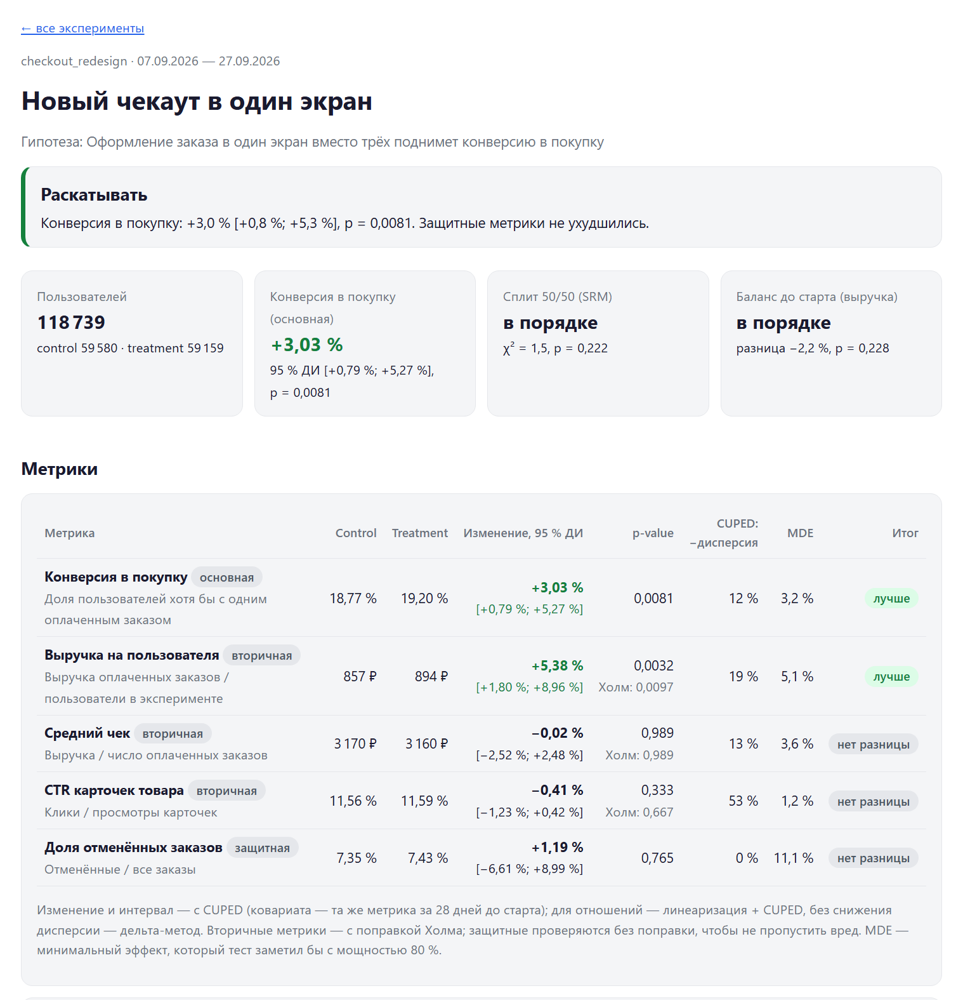
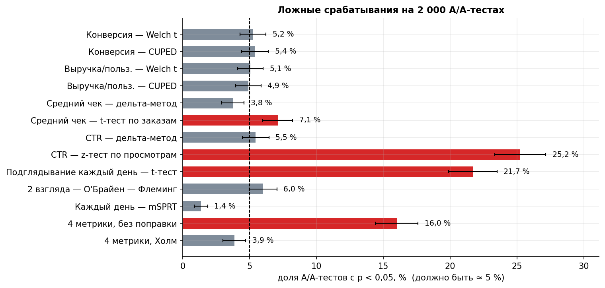

# abengine — движок анализа A/B-экспериментов

[](https://github.com/Alex91132/ab-testing-engine/actions/workflows/tests.yml)

**[Отчёты по экспериментам](https://alex91132.github.io/ab-testing-engine/)** ·
**[Разбор методов в Jupyter](notebooks/ab_methods.ipynb)** ·
[Сайт-портфолио](https://alex91132.github.io/)

Python-пакет, который делает с A/B-тестом то же, что платформа экспериментов внутри продуктовой компании:
берёт сырые логи из хранилища, считает метрики на SQL, проверяет здоровье эксперимента, применяет
правильный статистический метод к каждой метрике и собирает HTML-отчёт с решением.

```
логи в DuckDB ──SQL──▶ суммы по пользователям ──▶ SRM и баланс ──▶ CUPED · дельта-метод · Холм ──▶ mSPRT по дням ──▶ решение + HTML
```

Каждый метод проверен **симуляцией на 3 000 экспериментов**: правильная процедура держит долю ложных
срабатываний на уровне α = 5 % и при этом ловит эффект как можно чаще.



## Демонстрационные эксперименты

Синтетический интернет-магазин: 150 000 пользователей, 4 недели истории и 3 недели экспериментов.
Четыре эксперимента идут одновременно с независимым хешированием пользователей; в каждом заложена
своя ситуация, и отчёт должен её распознать.

| Эксперимент | Что заложено | Решение отчёта |
|---|---|---|
| [Новый чекаут](https://alex91132.github.io/ab-testing-engine/reports/checkout_redesign.html) | +6 % к вероятности покупки | **Раскатывать:** конверсия +3,0 % [+0,8 %; +5,3 %], выручка на пользователя +5,4 % |
| [Блок рекомендаций v2](https://alex91132.github.io/ab-testing-engine/reports/recommendations_v2.html) | CTR +6 %, но отмены +20 % и эффект новизны | **Не раскатывать:** CTR +6,7 %, но доля отмен +36 % — сработала защитная метрика |
| [A/A-проверка](https://alex91132.github.io/ab-testing-engine/reports/aa_platform_check.html) | группы одинаковы | **Эффект не обнаружен** ни в одной метрике |
| [Баннер акции](https://alex91132.github.io/ab-testing-engine/reports/promo_banner.html) | баг: у малоактивных в treatment теряются записи о назначении | **Невалидный эксперимент:** SRM 59 230 : 57 211, p < 0,0001; treatment «богаче» ещё до старта |

## Проверка методов

`scripts/run_validation.py`: 2 000 A/A-тестов (эффекта нет) и 1 000 A/B-тестов (эффект есть), каждый на свежей
популяции из 20 000 пользователей, 14 дней.

| Процедура | Ложные срабатывания, A/A | Мощность, A/B |
|---|---:|---:|
| Конверсия — Welch t / **CUPED** | 5,2 % / 5,4 % | 50,0 % / **53,8 %** |
| Выручка на пользователя — Welch t / **CUPED** | 5,1 % / 4,9 % | 72,5 % / **79,1 %** |
| Средний чек — **дельта-метод** / t-тест по заказам | 3,8 % / *7,1 %* | 28,9 % / — |
| CTR — **дельта-метод** / z-тест по просмотрам | 5,5 % / ***25,2 %*** | 56,1 % / — |
| Конверсия по дням: t-тест каждый день | ***21,7 %*** | — |
| Конверсия по дням: **О'Брайен — Флеминг**, 2 взгляда | 6,0 % | 52,1 % |
| Конверсия по дням: **mSPRT**, каждый день | 1,4 % | 23,7 % |
| 4 вторичные метрики: без поправки / **Холм** | *16,0 %* / 3,9 % | — |



Выводы:

* **Единица анализа = единица рандомизации.** CTR, посчитанный по просмотрам как по независимым наблюдениям,
  даёт ложную значимость в каждом четвёртом A/A-тесте. Дельта-метод по пользовательским суммам держит 5 % и
  совпадает с бутстрепом (SE среднего чека 29,5 ₽ против 29,1 ₽ у бутстрепа; «по заказам» — 25,1 ₽).
* **CUPED** — бесплатная мощность: снижение дисперсии 12 % у конверсии, 19 % у выручки, 53 % у CTR
  (для CTR это тот же результат на вдвое меньшем трафике); ложные срабатывания не растут.
* **Подглядывание** каждый день вчетверо раздувает ошибку I рода. О'Брайен — Флеминг с двумя запланированными
  взглядами почти не теряет мощности; mSPRT разрешает смотреть сколько угодно, но платит мощностью.
  Мощность ежедневного t-теста «выше» только потому, что он чаще срабатывает вообще.
* **Холм** возвращает вероятность хотя бы одной ложной находки среди 4 метрик с 16 % к ≤ 5 %.

## Методы

| Задача | Метод | Где |
|---|---|---|
| Метрики из логов | SQL в DuckDB: суммы по пользователю с дня первого захода и за 28 дней до старта | `metrics.py` |
| Назначение | `md5(соль:user_id)` → корзина 0–9999; разные соли — независимые эксперименты | `simulate.py` |
| Здоровье | SRM — χ²-тест соотношения групп (порог 0,001); баланс выручки до старта | `stats.py`, `analysis.py` |
| Средние по пользователям | Welch t-тест; относительный эффект и интервал согласованы с p-value | `stats.mean_test` |
| Снижение дисперсии | CUPED (Deng et al., 2013), θ по обеим группам | `stats.cuped` |
| Метрики-отношения | дельта-метод; линеаризация (Budylin et al., 2018) + CUPED | `stats.ratio_test`, `ratio_cuped` |
| Много метрик | Холм для вторичных; защитные без поправки | `stats.holm` |
| Последовательный анализ | mSPRT со всегда-валидными p-value и интервалами (Johari et al., 2017); границы О'Брайена — Флеминга | `stats.msprt`, `obf_boundaries` |
| Решение | SRM → защитные метрики → основная метрика → MDE, если эффекта нет | `analysis.decide` |

## Запуск

```bash
python -m venv .venv
.venv/Scripts/activate            # Linux/macOS: source .venv/bin/activate
pip install -r requirements.txt
export PYTHONPATH=src             # PowerShell: $env:PYTHONPATH = "src"

python -m abengine generate                  # логи магазина → data/shop.duckdb (~10 с)
python -m abengine report --out docs         # отчёты → docs/reports/*.html и docs/index.html
python -m abengine report --experiment checkout_redesign --out docs
pytest -q                                    # 13 тестов: статистика против эталонов, SQL против pandas
python scripts/run_validation.py             # 3 000 симуляций → results/ (~3 минуты на 8 ядрах)
```

Отчёт — один HTML-файл без JavaScript и внешних библиотек: графики — SVG, нарисованный на CSS-переменных,
поэтому он одинаково читается в светлой и тёмной теме и открывается откуда угодно.

## Тесты

* Welch — против `scipy.stats.ttest_ind`; CUPED — против регрессии `y ~ treat + x`, снижение дисперсии ≈ ρ²;
  дельта-метод — против бутстрепа; линеаризация — против дельта-метода; Холм и BH — на известных значениях;
  границы О'Брайена — Флеминга — против таблицы Jennison & Turnbull (3,471 / 2,454 / 2,004).
* SQL-метрики — против независимого пересчёта по сырым таблицам в pandas; дневные суммы складываются в итоговые.
* Назначение детерминировано, 50/50 и независимо между солями; сломанный эксперимент помечается невалидным.

## Структура

```
src/abengine/
  simulate.py   поведение пользователей, назначение по хешу, эффекты
  dataset.py    логи магазина → DuckDB
  metrics.py    определения метрик и SQL
  stats.py      тесты, CUPED, дельта-метод, SRM, поправки, mSPRT, О'Брайен — Флеминг
  analysis.py   анализ эксперимента и решение
  report.py     HTML-отчёт и список экспериментов
  validate.py   проверка методов симуляциями
scripts/        прогон проверки
notebooks/      разбор методов
docs/           отчёты для GitHub Pages и картинки
tests/          pytest; CI — GitHub Actions
```

## Ограничения

* Данные синтетические; поведение пользователей упрощено (не больше одного заказа в день, нет сезонности
  внутри дня, нет межгрупповой интерференции).
* Доля информации для границ О'Брайена — Флеминга берётся по числу пользователей; для накопительной метрики
  это приближение — на симуляции ложных срабатываний 6,0 % вместо 5 %.
* mSPRT консервативен (1,4 % вместо 5 %) и требует задать масштаб ожидаемого эффекта τ.
* Нет байесовского анализа, стратификации и автоматического поиска гетерогенных эффектов.

Связанные проекты: [симулятор A/B-тестов](https://alex91132.github.io/ab-simulator/) — размер выборки,
мощность, «проклятие победителя»; [причинный анализ эффекта ГРП](https://github.com/Alex91132/gtm-causal-inference) —
что делать, когда рандомизации нет.
